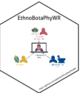

<!-- README.md is generated from README.qmd. Please edit that file -->

# EthnoBotaPhyWR 

<!-- badges: start -->

[](https://lifecycle.r-lib.org/articles/stages.html#experimental)
[](https://github.com/adafede/EthnoBotaPhyWR/actions/workflows/R-CMD-check.yaml)
[](https://adafede.r-universe.dev/EthnoBotaPhyWR)
<!-- badges: end -->

**EthnoBotaPhyWR** combines ethnobotanical use records and phytochemical
occurrence data from Wikidata and LOTUS on Open Tree of Life
phylogenies.

## Scope and exported API

The package exports a single pipeline entry point alongside curated
*Orchidaceae* datasets:

- `ethnobotafever_tree()` runs the end-to-end analysis for any plant
  family, querying Wikidata (via QLever), Open Tree of Life, and
  NPClassifier, computing diversity and phylogenetic metrics, and
  exporting trees, tables, and iTOL annotations.
- `orchids_compounds` (3,055 rows), `orchids_compound_classes` (1,574
  rows), and `orchids_ethnobotanical` (419 rows) are curated plain
  `data.frame` objects for *Orchidaceae*.
- `trees_dec344ba7ea88a268b3feac0403844a3` and
  `trees_9f61da756dff1e09426c110eefce3824` store precomputed Open Tree
  of Life `phylo` caches for the bundled *Orchidaceae* run.
- `system.file("extdata", "itol", package = "EthnoBotaPhyWR")` provides
  precomputed Newick trees (`.tre`) and iTOL v6 annotation files
  (`.txt`) for *Orchidaceae*.

All remaining helpers (tree caching, phylogenetic signal and ancestral
state calculation, NPClassifier lookup, hierarchy rollup, and plotting)
are internal to the package.

## Installation

Bioconductor packages `ggtree` and `ggtreeExtra` are required imports.
Install from r-universe (with CRAN and Bioconductor repositories
enabled):

``` r
install.packages(
  "EthnoBotaPhyWR",
  repos = c(
    "https://adafede.r-universe.dev",
    "https://davidgohel.r-universe.dev",
    "https://cran.r-universe.dev",
    "https://bioc.r-universe.dev"
  )
)
```

Or install the development version from GitHub:

``` r
remotes::install_github("adafede/EthnoBotaPhyWR")
```

Documentation articles are published on the package site: [Full pipeline
tutorial](https://adafede.github.io/EthnoBotaPhyWR/vignettes/articles/ethnobota_fever_tree.html)
and [Orchids
datasets](https://adafede.github.io/EthnoBotaPhyWR/vignettes/articles/orchids.html).

## Quick start

### Inspect bundled datasets and iTOL files (offline)

``` r
library(EthnoBotaPhyWR)

data(orchids_compounds)
data(orchids_compound_classes)
data(orchids_ethnobotanical)

dim(orchids_compounds)
dim(orchids_compound_classes)
dim(orchids_ethnobotanical)

itol_dir <- system.file("extdata", "itol", package = "EthnoBotaPhyWR")
list.files(itol_dir)
```

### Interactive exploration on iTOL

To inspect either the bundled *Orchidaceae* outputs or files written to
`<dirname(export_table_counts)>/itol/` by `ethnobotafever_tree()`:

1.  Upload one of the `.tre` files (`*_full_genera_tree.tre`,
    `*_phyto_genera_tree.tre`, or `*_phyto_species_tree.tre`) to
    <https://itol.embl.de/upload.cgi>.
2.  Drag and drop its three companion annotation files onto the tree
    canvas:
    - `*_itol_ethnobotany.txt` (`DATASET_GRADIENT`: $\log_{10}$
      ethnobotanical species count)
    - `*_itol_species_richness.txt` (`DATASET_SIMPLEBAR`: known species
      count per taxon)
    - `*_itol_compounds_multibar.txt` (`DATASET_MULTIBAR`: stacked
      compound superclass counts colored by pathway)

### Analyze a plant family (requires network access)

``` r
out_dir <- file.path(tempdir(), "ethnobotaphywr_demo")
dir.create(out_dir, recursive = TRUE, showWarnings = FALSE)

result <- ethnobotafever_tree(
  taxon_name = "Orchidaceae",
  n_multiple_genera = 10L,
  n_ethnobotanical_count_min = 10L,
  n_compounds_count_min = 50L,
  example_family_names = c("Solanaceae", "Fabaceae"),
  path_molecules = orchids_compounds,
  path_classes = orchids_compound_classes,
  path_ethnobotanical = orchids_ethnobotanical,
  export_tree_full = file.path(out_dir, "orchids_tree_full.svg"),
  export_tree_phyto = file.path(out_dir, "orchids_tree_phyto.svg"),
  export_tree_phyto_sub = file.path(out_dir, "orchids_tree_phyto_sub.svg"),
  export_table_classified = file.path(out_dir, "orchids_classified.tsv"),
  export_table_counts = file.path(out_dir, "orchids_counts.tsv"),
  export_table_counts_sub = file.path(out_dir, "orchids_counts_sub.tsv"),
  local_cache = file.path(out_dir, "cache"),
  log_dir = out_dir
)
```

## Limitations

- **Source database bias and incompleteness**: Wikidata and LOTUS record
  only published and digitized occurrences; zero or low counts for a
  taxon reflect lack of curated records rather than true biological
  absence.
- **Topological branch lengths**: Open Tree of Life synthetic subtrees
  do not provide calibrated divergence times. Phylogenetic ancestral
  state reconstruction (`method = "phylo"`) and Blomberg’s $K$ use
  Grafen branch lengths as a topological approximation.
- **External service dependency**: Running `ethnobotafever_tree()`
  without complete local tables and caches requires live HTTP access to
  QLever (Wikidata endpoint), the Open Tree of Life v3 API, and GNPS2
  NPClassifier.

## Main data source citations

- LOTUS: <https://doi.org/10.7554/eLife.70780>
- Open Tree Taxonomy: <https://doi.org/10.3897/BDJ.5.e12581>
- NPClassifier: <https://doi.org/10.1021/acs.jnatprod.1c00399>

## Additional software credits

| Package | Version | Citation |
|:---|:---|:---|
| ape | 5.8.1 | Paradis and Schliep (2019) |
| base | 4.6.2 | R Core Team (2026) |
| BiocManager | 1.30.27 | Morgan and Ramos (2025) |
| BiocVersion | 3.23.1 | Morgan (2025) |
| curl | 8.1.0 | Ooms (2026) |
| data.table | 1.18.6.1 | Barrett et al. (2026) |
| EthnoBotaPhyWR | 0.0.0.9001 | Rutz (2026) |
| ggiraph | 0.9.6 | Gohel and Skintzos (2026) |
| ggtree | 4.2.0 | Yu et al. (2017); Yu et al. (2018); Yu (2020); Yu (2022a); Xu et al. (2022) |
| ggtreeExtra | 1.22.1 | Xu et al. (2021); Yu (2022b) |
| gt | 1.4.0 | Iannone et al. (2026) |
| htmlwidgets | 1.6.4 | Vaidyanathan et al. (2023) |
| khroma | 1.17.0 | Frerebeau (2025) |
| knitr | 1.52 | Xie (2014); Xie (2015); Xie (2026) |
| logger | 0.4.3 | Daróczi and Wickham (2026) |
| rmarkdown | 2.32 | Xie et al. (2018); Xie et al. (2020); Allaire et al. (2026) |
| rotl | 3.1.1 | Michonneau et al. (2016); OpenTreeOfLife et al. (2019) |
| spelling | 2.3.2 | Ooms and Hester (2025) |
| testthat | 3.3.2 | Wickham (2011) |
| tidytable | 0.11.2 | Fairbanks (2024) |
| tidyverse | 2.0.0 | Wickham et al. (2019) |

<div id="refs" class="references csl-bib-body hanging-indent">

<div id="ref-rmarkdown2026" class="csl-entry">

Allaire, JJ, Yihui Xie, Christophe Dervieux, et al. 2026.
*<span class="nocase">rmarkdown</span>: Dynamic Documents for r*.
<https://github.com/rstudio/rmarkdown>.

</div>

<div id="ref-datatable" class="csl-entry">

Barrett, Tyson, Matt Dowle, Arun Srinivasan, et al. 2026.
*<span class="nocase">data.table</span>: Extension of
“<span class="nocase">data.frame</span>”*.
<https://doi.org/10.32614/CRAN.package.data.table>.

</div>

<div id="ref-logger" class="csl-entry">

Daróczi, Gergely, and Hadley Wickham. 2026.
*<span class="nocase">logger</span>: A Lightweight, Modern and Flexible
Logging Utility*. <https://doi.org/10.32614/CRAN.package.logger>.

</div>

<div id="ref-tidytable" class="csl-entry">

Fairbanks, Mark. 2024. *<span class="nocase">tidytable</span>: Tidy
Interface to “<span class="nocase">data.table</span>”*.
<https://doi.org/10.32614/CRAN.package.tidytable>.

</div>

<div id="ref-khroma" class="csl-entry">

Frerebeau, Nicolas. 2025. *<span class="nocase">khroma: Colour Schemes
for Scientific Data Visualization</span>*. Université Bordeaux
Montaigne. <https://doi.org/10.5281/zenodo.1472077>.

</div>

<div id="ref-ggiraph" class="csl-entry">

Gohel, David, and Panagiotis Skintzos. 2026.
*<span class="nocase">ggiraph</span>: Make
“<span class="nocase">ggplot2</span>” Graphics Interactive*.
<https://doi.org/10.32614/CRAN.package.ggiraph>.

</div>

<div id="ref-gt" class="csl-entry">

Iannone, Richard, Joe Cheng, Barret Schloerke, et al. 2026.
*<span class="nocase">gt</span>: Easily Create Presentation-Ready
Display Tables*. <https://doi.org/10.32614/CRAN.package.gt>.

</div>

<div id="ref-rotl2016" class="csl-entry">

Michonneau, Francois, Joseph W. Brown, and David J. Winter. 2016.
“<span class="nocase">rotl</span>: An r Package to Interact with the
Open Tree of Life Data.” *Methods in Ecology and Evolution* 7 (12):
1476–81. <https://doi.org/10.1111/2041-210X.12593>.

</div>

<div id="ref-BiocVersion" class="csl-entry">

Morgan, Martin. 2025. *BiocVersion: Set the Appropriate Version of
Bioconductor Packages*.

</div>

<div id="ref-BiocManager" class="csl-entry">

Morgan, Martin, and Marcel Ramos. 2025. *BiocManager: Access the
Bioconductor Project Package Repository*.
<https://doi.org/10.32614/CRAN.package.BiocManager>.

</div>

<div id="ref-curl" class="csl-entry">

Ooms, Jeroen. 2026. *<span class="nocase">curl</span>: A Modern and
Flexible Web Client for r*.
<https://doi.org/10.32614/CRAN.package.curl>.

</div>

<div id="ref-spelling" class="csl-entry">

Ooms, Jeroen, and Jim Hester. 2025.
*<span class="nocase">spelling</span>: Tools for Spell Checking in r*.
<https://doi.org/10.32614/CRAN.package.spelling>.

</div>

<div id="ref-rotl2019" class="csl-entry">

OpenTreeOfLife, Benjamin Redelings, Luna Luisa Sanchez Reyes, et al.
2019. *Open Tree of Life Synthetic Tree*. Version 12.3. Zenodo.
<https://doi.org/10.5281/zenodo.3937741>.

</div>

<div id="ref-ape" class="csl-entry">

Paradis, Emmanuel, and Klaus Schliep. 2019. “Ape 5.0: An Environment for
Modern Phylogenetics and Evolutionary Analyses in R.” *Bioinformatics*
35: 526–28. <https://doi.org/10.1093/bioinformatics/bty633>.

</div>

<div id="ref-base" class="csl-entry">

R Core Team. 2026. *R: A Language and Environment for Statistical
Computing*. R Foundation for Statistical Computing.
<https://doi.org/10.32614/R.manuals>.

</div>

<div id="ref-EthnoBotaPhyWR" class="csl-entry">

Rutz, Adriano. 2026. *EthnoBotaPhyWR: Infrastructure for Ethnobotanical
and Phytochemical Data Integration with Wikidata*.
<https://adafede.github.io/EthnoBotaPhyWR/>.

</div>

<div id="ref-htmlwidgets" class="csl-entry">

Vaidyanathan, Ramnath, Yihui Xie, JJ Allaire, Joe Cheng, Carson Sievert,
and Kenton Russell. 2023. *<span class="nocase">htmlwidgets</span>: HTML
Widgets for r*. <https://doi.org/10.32614/CRAN.package.htmlwidgets>.

</div>

<div id="ref-testthat" class="csl-entry">

Wickham, Hadley. 2011. “<span class="nocase">testthat</span>: Get
Started with Testing.” *The R Journal* 3: 5–10.
<https://journal.r-project.org/articles/RJ-2011-002/>.

</div>

<div id="ref-tidyverse" class="csl-entry">

Wickham, Hadley, Mara Averick, Jennifer Bryan, et al. 2019. “Welcome to
the <span class="nocase">tidyverse</span>.” *Journal of Open Source
Software* 4 (43): 1686. <https://doi.org/10.21105/joss.01686>.

</div>

<div id="ref-knitr2014" class="csl-entry">

Xie, Yihui. 2014. “<span class="nocase">knitr</span>: A Comprehensive
Tool for Reproducible Research in R.” In *Implementing Reproducible
Computational Research*, edited by Victoria Stodden, Friedrich Leisch,
and Roger D. Peng. Chapman; Hall/CRC.

</div>

<div id="ref-knitr2015" class="csl-entry">

Xie, Yihui. 2015. *Dynamic Documents with R and Knitr*. 2nd ed. Chapman;
Hall/CRC. <https://yihui.org/knitr/>.

</div>

<div id="ref-knitr2026" class="csl-entry">

Xie, Yihui. 2026. *<span class="nocase">knitr</span>: A General-Purpose
Package for Dynamic Report Generation in R*. <https://yihui.org/knitr/>.

</div>

<div id="ref-rmarkdown2018" class="csl-entry">

Xie, Yihui, J. J. Allaire, and Garrett Grolemund. 2018. *R Markdown: The
Definitive Guide*. Chapman; Hall/CRC.
<https://pkg.yihui.org/rmarkdown-book/>.

</div>

<div id="ref-rmarkdown2020" class="csl-entry">

Xie, Yihui, Christophe Dervieux, and Emily Riederer. 2020. *R Markdown
Cookbook*. Chapman; Hall/CRC.
<https://pkg.yihui.org/rmarkdown-cookbook/>.

</div>

<div id="ref-ggtreeExtra2021" class="csl-entry">

Xu, Shuangbin, Zehan Dai, Pingfan Guo, et al. 2021.
“<span class="nocase">ggtreeExtra</span>: Compact Visualization of
Richly Annotated Phylogenetic Data.” *Molecular Biology and Evolution*
38 (June): 4039–42. <https://doi.org/10.1093/molbev/msab166>.

</div>

<div id="ref-ggtree2022b" class="csl-entry">

Xu, Shuangbin, Lin Li, Xiao Luo, et al. 2022. “Ggtree: A Serialized Data
Object for Visualization of a Phylogenetic Tree and Annotation Data.”
*iMeta* 1 (4): e56. <https://doi.org/10.1002/imt2.56>.

</div>

<div id="ref-ggtree2020c" class="csl-entry">

Yu, Guangchuang. 2020. “Using Ggtree to Visualize Data on Tree-Like
Structures.” *Current Protocols in Bioinformatics* 69 (1): e96.
<https://doi.org/10.1002/cpbi.96>.

</div>

<div id="ref-ggtree2022a" class="csl-entry">

Yu, Guangchuang. 2022a. *Data Integration, Manipulation and
Visualization of Phylogenetic Treess*. 1st edition. Chapman; Hall/CRC.
<https://doi.org/10.1201/9781003279242>.

</div>

<div id="ref-ggtreeExtra2022" class="csl-entry">

Yu, Guangchuang. 2022b. *Data Integration, Manipulation and
Visualization of Phylogenetic Treess*. 1st edition. Chapman; Hall/CRC.
<https://www.amazon.com/Integration-Manipulation-Visualization-Phylogenetic-Computational-ebook/dp/B0B5NLZR1Z/>.

</div>

<div id="ref-ggtree2018d" class="csl-entry">

Yu, Guangchuang, Tommy Tsan-Yuk Lam, Huachen Zhu, and Yi Guan. 2018.
“Two Methods for Mapping and Visualizing Associated Data on Phylogeny
Using Ggtree.” *Molecular Biology and Evolution* 35: 3041–43.
<https://doi.org/10.1093/molbev/msy194>.

</div>

<div id="ref-ggtree2017e" class="csl-entry">

Yu, Guangchuang, David Smith, Huachen Zhu, Yi Guan, and Tommy Tsan-Yuk
Lam. 2017. “<span class="nocase">ggtree</span>: An r Package for
Visualization and Annotation of Phylogenetic Trees with Their Covariates
and Other Associated Data.” *Methods in Ecology and Evolution* 8: 28–36.
<https://doi.org/10.1111/2041-210X.12628>.

</div>

</div>
