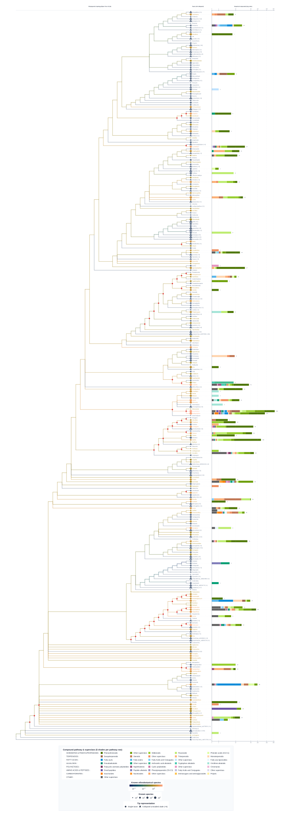
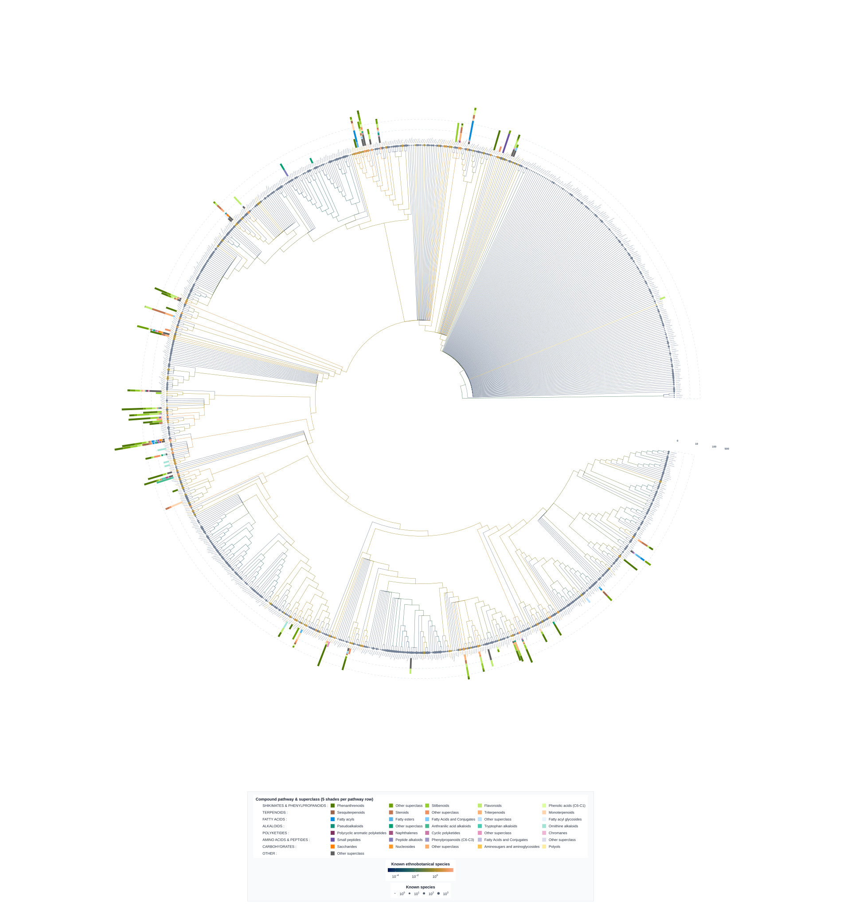
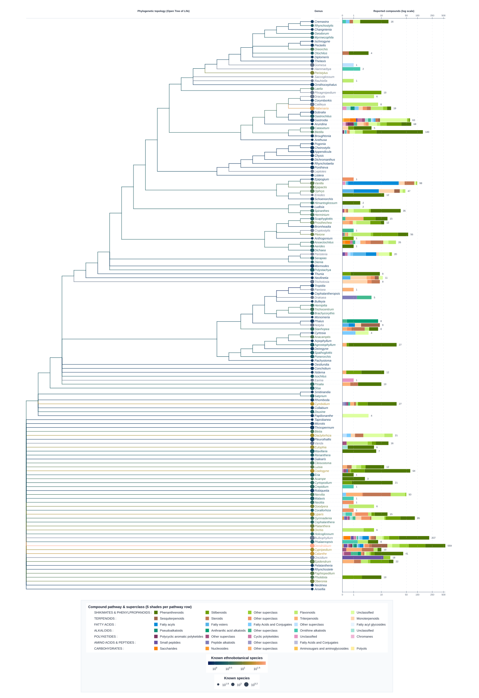
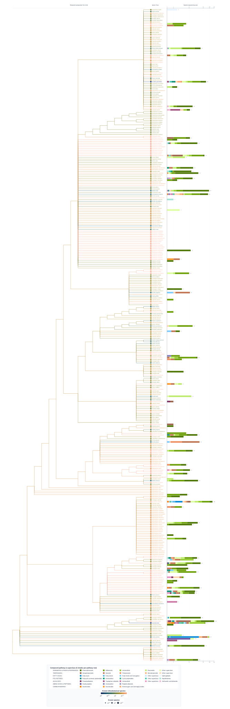

**EthnoBotaPhyWR** stands for *ethnobotany*, *phytochemistry*, *Wikidata* and
*R* [(maybe you can also find the *bot* of *robot*)]{.smallcaps} It should be
pronounced "Ethnobota Fever".

```{r}
#| label: install
#| eval: false
#| include: false

install.packages(
  "EthnoBotaPhyWR",
  repos = c(
    "https://adafede.r-universe.dev",
    # required for ggiraph, required for ggtree
    "https://davidgohel.r-universe.dev",
    "https://cran.r-universe.dev",
    "https://bioc.r-universe.dev"
  )
)
```

```{r}
#| label: imports
#| include: false

## No need to source colors.R from cascade — the functions and
## color palettes are now vendored as internal functions in
## R/cascade_*.R (see DESCRIPTION for rationale).
library(EthnoBotaPhyWR)
```

## Introduction

This vignette illustrates how to collect data on the *ethnobotanical uses*, and
the *phytochemistry* of a given taxonomic family. The data collected originate
from [Wikidata](https://www.wikidata.org/wiki/Wikidata:Main_Page), the free
knowledge base that anyone can edit.

At the moment, this vignette supports adding your own data and combine them with
the ones available on Wikidata to see the results. Ideally, you should share
these precious data.

### Pipeline overview

The function you are looking for is `ethnobotafever_tree()`, whose parameters
are described below:

```{r}
#| label: parameters

## Taxonomy-related parameters
# The scientific name of the family of interest
taxon_name <- "Orchidaceae"

# The scientific name(s) of family(ies) to compare against
example_family_names <- c(
  "Poaceae" = "Poaceae",
  "Fabaceae" = "Fabaceae",
  "Asteraceae" = "Asteraceae",
  "Orchidaceae" = "Orchidaceae",
  "Rosaceae" = "Rosaceae",
  "Solanaceae" = "Solanaceae"
)

## Thresholds
# Minimal number of genera where a compound is found to consider it widespread
n_multiple_genera <- 10L
# Minimal species per genus with reported ethnobotanical use
n_ethnobotanical_count_min <- 10L
# Minimal compounds reported in a taxon to consider it widely investigated
n_compounds_count_min <- 50L
```

```{r}
#| label: dirs
#| message: false
#| warning: false

## File paths
pkg_root <- tryCatch(
  {
    p <- "."
    for (i in seq_len(10L)) {
      has_desc <- file.exists(file.path(p, "DESCRIPTION"))
      has_raw <- dir.exists(file.path(p, "data-raw"))
      if (has_desc && has_raw) {
        break
      }
      p <- file.path(p, "..")
    }
    normalizePath(p)
  },
  error = function(e) normalizePath(".")
)
cache_dir <- file.path(pkg_root, "data")
log_dir <- file.path(pkg_root, "data-raw")
figures_dir <- file.path(pkg_root, "man", "figures")
dir.create(figures_dir, recursive = TRUE, showWarnings = FALSE)

path_molecules <- EthnoBotaPhyWR::orchids_compounds
path_classes <- EthnoBotaPhyWR::orchids_compound_classes
path_ethnobotanical <- EthnoBotaPhyWR::orchids_ethnobotanical

export_tree_full <- file.path(figures_dir, "tree_orchids_full.svg")
export_tree_phyto <- file.path(figures_dir, "tree_orchids_phyto.svg")
export_tree_phyto_sub <- file.path(figures_dir, "tree_orchids_phyto_sub.svg")
export_table_classified <- file.path(
  pkg_root,
  "data-raw",
  "orchids_table_unique_connectivity_classified.tsv"
)
export_table_counts <- file.path(
  pkg_root,
  "data-raw",
  "orchids_table_counts.tsv"
)
export_table_counts_sub <- file.path(
  pkg_root,
  "data-raw",
  "orchids_table_counts_sub.tsv"
)

local_cache <- cache_dir
dir.create(log_dir, recursive = TRUE, showWarnings = FALSE)
```

Adjust these parameters as needed before running the pipeline:

```{r}
#| label: ethnobotafever_tree
#| message: false
#| warning: false

results <- ethnobotafever_tree(
  taxon_name = taxon_name,
  n_multiple_genera = n_multiple_genera,
  n_ethnobotanical_count_min = n_ethnobotanical_count_min,
  n_compounds_count_min = n_compounds_count_min,
  example_family_names = example_family_names,
  path_molecules = path_molecules,
  path_classes = path_classes,
  path_ethnobotanical = path_ethnobotanical,
  export_tree_full = export_tree_full,
  export_tree_phyto = export_tree_phyto,
  export_tree_phyto_sub = export_tree_phyto_sub,
  export_table_classified = export_table_classified,
  export_table_counts = export_table_counts,
  export_table_counts_sub = export_table_counts_sub,
  local_cache = local_cache,
  log_dir = log_dir
)
```

## Results {#sec-results}

This returns the following objects:

First, tables containing different information:

- An overview of the phytochemistry of the family in @tbl-1
- An overview of the number of reported uses, compounds, and species per genus
  within the family in @tbl-2, along with NPClassifier superclass Shannon
  entropy (`shannon_diversity`), Hill diversity ($^1D = \exp(H')$, `hill_q1`),
  Empirical Bayes shrunken ethnobotanical proportion (`ethnobotanical_rate_eb`),
  and log-log species-richness-adjusted compound residual (`compounds_residual`)
- An overview of the species within the family for which a decent number of
  compounds or uses have been reported in @tbl-3

```{r}
#| echo: false
#| label: tbl-1
#| tbl-cap: "Overview of the phytochemistry of the family"

results$df_taxa_full |>
  data.frame() |>
  gt::gt() |>
  gt::opt_interactive()
```

```{r}
#| echo: false
#| label: tbl-2
#| tbl-cap: >-
#|   Overview of the number of reported uses, compounds, and species per genus
#|   within the family

results$df_taxa_ethno_counted |>
  data.frame() |>
  gt::gt() |>
  gt::opt_interactive()
```

```{r}
#| echo: false
#| label: tbl-3
#| tbl-cap: >-
#|   Overview of the species within the family for which a decent number of
#|   compounds or uses have been reported

results$df_taxa_known_sub |>
  data.frame() |>
  gt::gt() |>
  gt::opt_interactive()
```

Second, tree-based visualizations (each exported simultaneously as `.svg`,
publication-ready vector `.pdf`, and a self-contained interactive `.html` widget
with a live taxon search bar, hover tooltips, and pan/zoom):

- **Clade-collapsed rectangular genus overview** (@fig-1): displays all active
  genera individually (`●`, italic labels) while collapsing purely unstudied
  clades and polytomies into summary rows (`▲`, upright labels showing
  `(+N genera)`), preserving exact tip-weighted branch averages.
- **Uncollapsed circular (`fan`) supplementary genus overview**
  (`tree_orchids_full_circular_si.{svg,pdf,html}`, @fig-1b): displays all 847
  placed genera without collapsing for supplementary materials.
- **Phytochemical & ethnobotanical genus tree** (@fig-2): restricted to genera
  with reported compounds or ethnobotanical uses.
- **Species-level phytochemical tree** (@fig-3): displays species within the
  most widely investigated genera, highlighting coverage gaps even within
  well-studied genera.

In all trees:

- **Phylogenetic ancestral state reconstruction & hot clades**: internal
  branches are colored using Felsenstein pruning ML ancestral state
  reconstruction on Grafen-calibrated branch lengths (`method = "phylo"`), and
  clades significantly enriched in ethnobotanical uses (species-weighted
  hypergeometric test, Benjamini-Hochberg $\text{FDR } q < 0.05$) are marked
  with red diamonds (`♦`).
- **Compound bar scale & counts**: total bar length scales with
  $\log(1 + \text{compounds})$ (with a reference log-scale axis at the top of
  the bar column and the exact integer compound count printed at the right tip
  of each bar), while segments inside each bar preserve the exact within-taxon
  superclass proportions, and tip circle areas scale with $\log_{10}$ species
  richness.
- **Hierarchical 6-column legend**: each row corresponds to one NPClassifier
  chemical pathway (`[Pathway]` in column 1 followed by its 5 `microshades`
  subclasses ordered from darkest to lightest across columns 2--6).

{#fig-1 width=100%}

{#fig-1b width=100%}

{#fig-2 width=100%}

{#fig-3 width=100%}

### Using the Exported Newick Trees & Annotations on iTOL

Running `ethnobotafever_tree()` automatically writes Newick `.tre` trees and
official iTOL v6 annotation files to
`file.path(dirname(export_table_counts), "itol")`. For *Orchidaceae*, these
files are also shipped inside the package and can be located with:

```{r}
#| label: itol-files

itol_dir <- system.file("extdata", "itol", package = "EthnoBotaPhyWR")
list.files(itol_dir)
```

To explore any of the three trees (`*_full_genera`, `*_phyto_genera`, or
`*_phyto_species`) interactively on [iTOL (Interactive Tree Of
Life)](https://itol.embl.de):

1. Go to <https://itol.embl.de/upload.cgi> and upload the `*_tree.tre` Newick
   file.
2. Open the uploaded tree and **drag and drop** its three companion `.txt` files
   directly onto the iTOL tree canvas:
   - `*_itol_ethnobotany.txt` (`DATASET_GRADIENT` --- $\log_{10}$ ethnobotanical
     species richness)
   - `*_itol_species_richness.txt` (`DATASET_SIMPLEBAR` --- total known species
     per taxon)
   - `*_itol_compounds_multibar.txt` (`DATASET_MULTIBAR` --- stacked compound
     superclass counts with matching `microshades` hex colors)
3. In the iTOL control panel (**Datasets** tab), toggle datasets on/off, search
   any taxon, or click any internal node to collapse, expand, or prune clades.

## Logs

```{r}
#| label: logs
#| echo: false

readLines(con = results$log_file)
```
